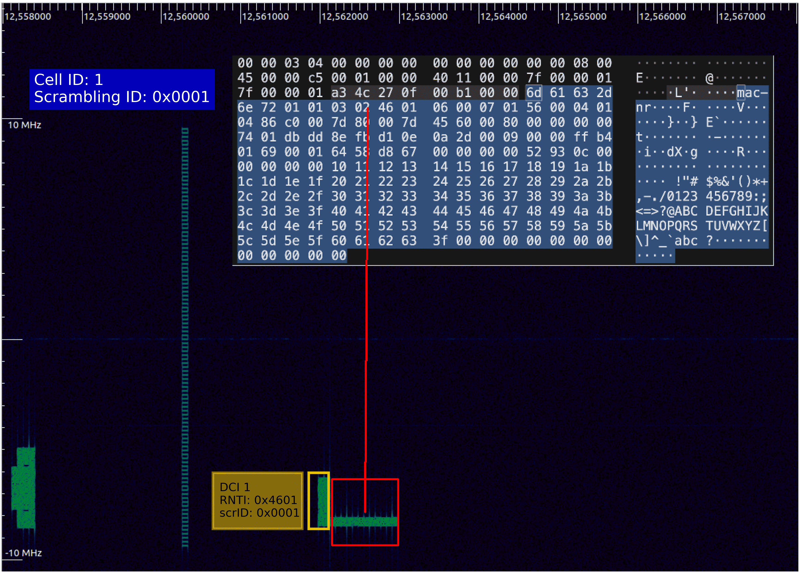

# Golden Sniffer - Low-Complexity 5G NR Signal Interception

[](https://www.mathworks.com/products/matlab.html)
[](https://www.3gpp.org/)
[](LICENSE)

**Golden Sniffer** is a low-complexity passive 5G NR sniffer that exploits the deterministic structure of the **Gold sequences** used by the DM-RS (Demodulation Reference Signals) to blindly detect and decode the downlink control and data channels. Instead of an exhaustive search over RNTIs, it reads the DM-RS scrambling ID directly from the phases of the PDCCH DM-RS, and recovers the RNTI and the DCI size by linear algebra over GF(2), achieving a >94% DCI detection rate.

## 🔬 Research Contributions

This tool implements the following techniques for 5G NR passive monitoring:

1. **Power-clustering PDCCH search space detection**: only the power clusters in the CORESET are considered as DCI candidates
2. **DM-RS-guided blind search**: exploits the Gold sequence generation rule to extract the PDCCH DM-RS scrambling ID directly from the received DM-RS
3. **Blind RNTI extraction through linear inversion over GF(2)**: in the high-SNR limit, the RNTI and the DCI payload size are recovered with fast linear algebra over GF(2)
4. **Single-layer PDSCH decoding with BWP and ZP-CSI-RS identification**: the PHY parameters are validated by decoding the DL-SCH

## 🎯 Key Features

- **Gold Sequence Exploitation**: leverages the deterministic DM-RS generation to reduce the blind search complexity
- **DM-RS Scrambling ID Recovery**: phase-based technique that extracts the 16-bit scrambling ID from the PDCCH DM-RS without exhaustive search
- **Blind RNTI Discovery**: the UE RNTIs don't need to be known in advance
- **Robust Synchronization and Tracking**: the receiver does not require external time or frequency references
- **MIB/SIB1 Decoding**: system information extracted from the broadcast channels
- **Smart DCI Detection**: energy detection + phase verification to minimize false positives
- **PDSCH Decoding**: data channel decoding with MAC PDU export to PCAP files
- **Multi-UE Tracking**: simultaneous monitoring of multiple UEs
- **FDD/TDD Support**: works with both frequency and time division duplexing

### Supported Configurations

- FR1 (sub-6 GHz) with 15 or 30 kHz subcarrier spacing
- Downlink only (FDD and TDD)
- Fallback DCI formats 0_0 (UL grants) and 1_0 (DL grants)
- Aggregation levels 1, 2, 4, 8, 16; non-interleaved and interleaved CORESETs
- RNTI types: SI-RNTI, RA-RNTI, C-RNTI

## 📊 Performance Results

Validated on **80+ real-world captures** from operational 5G networks (srsRAN, Open5GS):

| Scenario | DCI Detection Rate | DCI 0_0 (UL) | DCI 1_0 (DL) |
|----------|-------------------|--------------|--------------|
| **Single UE (FDD)** | **92.20% ± 3.09%** | ✓ | ✓ |
| **Multi UE (FDD)** | **97.22% ± 2.04%** | ✓ | ✓ |
| **Multi UE (TDD)** | **94.66% ± 1.92%** | ✓ | ✓ |
| **Network Slicing** | **98.52% ± 0.54%** | ✓ | ✓ |

### Complexity Analysis

**Traditional Exhaustive Search** (per PDCCH candidate):
- DM-RS scrambling IDs to test: up to 65,536 (16-bit space)
- RNTIs to test: 65,536 (16-bit space)
- DCI sizes to test: ~22
- Every (RNTI, size) hypothesis requires a full polar decoding + CRC check

**Golden Sniffer (DM-RS-guided)** (per PDCCH candidate):
- The DM-RS scrambling ID is read from the DM-RS phases (no search)
- For each DCI size, one GF(2) linear solve checks the CRC consistency and returns the RNTI directly (no RNTI enumeration)
- Only the ~22 DCI sizes are tried

## 📦 Requirements

### MATLAB Toolboxes
- **5G Toolbox** (required)
- **Signal Processing Toolbox** (required)
- **Communications Toolbox** (required)

### Supported MATLAB Versions
- R2023a or later (recommended)
- R2025a or later (tested)

## 🚀 Quick Start

### Installation

```bash
git clone https://github.com/5G-GoldenSniffer/5G-GoldenSniffer
```

```matlab
cd 5G-GoldenSniffer
```

### Basic Usage

```matlab
% Run GoldenSniffer on the sample capture captures/iq_basic.sc16
addpath('examples');
example_basic
```

### Using the Artifact Evaluation Dataset

Download the dataset from https://doi.org/10.5281/zenodo.21678295 into the `captures/` folder, then:

```matlab
addpath('examples')
example_iq(id)       % id = 1:25 selects the gNB configuration
```

The dataset contains one capture per configuration (run 0). `example_iq(id, run)`, with `run` = 0:2
(default 0), selects further captures of the same configuration, when available.

`example_iq` dispatches to `example_iq_fdd` (ids 1–10, 19–22, 24, 25: 1980 MHz, files
`iq_1980M_23.04M_conf<id>_<run>.sc16`) or `example_iq_tdd` (ids 11–18, 23: 3820.02 MHz, files
`iq_3820.02M_23.04M_conf<id>_<run>.sc16`), which can also be called directly. The UE RNTIs are not given
to the sniffer (`config.KNOWN_UE_RNTIs = []`): they are discovered blindly.

### Ground Truth from the gNB Logs

`examples/dci_count.py` counts the DCIs of the selected RNTIs in a srsRAN gNB log over an SFN window, to be
compared with the sniffer's final report; `examples/dci_count_all` runs it for every configuration, with
the windows matching the captures:

```bash
cd examples
./dci_count.py -l ../captures/gnb_conf3.log --sfnini 934 --sfnfin 907 -r rnti=0x4601
```

## 📡 Supported Input Formats

| Format | Extension | Description |
|--------|-----------|-------------|
| Float32 Complex | `.fc32` | I/Q samples as 32-bit floats |
| Int16 Complex | `.sc16` | I/Q samples as 16-bit integers |

### Creating Captures

Use GNU Radio, USRP UHD, or similar tools:

```bash
# Using uhd_rx_cfile (USRP)
uhd_rx_cfile -f 1970e6 -r 15.36e6 --type=float32 capture.fc32

# Using GNU Radio (example flowgraph output)
# Configure UHD source → File Sink
```

## 🔧 Configuration Parameters

### Main Parameters

`GoldenSniffer(config)` takes a struct `config` with the following fields (see also `help GoldenSniffer`).
The examples build it from `examples/config_init.m`, `examples/config_add_impairments.m` and
`examples/config_output_params.m`, which set the defaults.

```matlab
  config.dir = 'captures';
  config.filename = 'capture.{fc32,sc16}';
      will open the raw I/Q sample capture file config.filename in the folder
      config.dir; interleaved complex float32 (fc32) or int16 (sc16) formats
      are supported

  config.carrier_frequency_MHz = 1980;
  config.frequency_offset_MHz = 0;
  config.bandwidth_MHz = 20;
  config.sample_rate_MHz = 23.04;
      specify the carrier frequency, a possible frequency offset with
      respect to the acquisition center frequency, the carrier bandwidth
      and the sampling rate, in MHz

  config.nzpCSI_known = false;
  config.search_unknown_nzpCSI = true;
  config.zpCSI_known = false;
      specify the parameters of the noCDM NZP-CSI-RS (density 3 and
      density 1) and ZP-CSI-RS (4RE x 1symbol), whose knowledge is
      necessary for successful PDSCH decoding of slots containing the
      CSI-RS (fields CSI1, CSI2 and CSI0, see examples/example_basic.m)
      if the _known variables are set to false and
      search_unknown_nzpCSI is true, the execution will pause when a
      valid configuration is found, so that the config variable can be
      updated for faster future runs

  config.PDSCH_decoding = true;
      if enabled, per-RNTI BWP detection, PDSCH format autodetection and
      DL-SCH decoding are attempted; successfully decoded allocations are
      saved to results/capture_<filename>.pcap

  config.KNOWN_UE_RNTIs = [];
      a list of RNTIs known to be present in the capture file;
      if empty, they are autodetected

  config.enable_NLOS_channel = false;
  config.SNR_reduction_dB = 0;
      artificially add a multipath channel (CDL/TDL models) and/or a
      signal-to-noise ratio degradation to the capture file (the phase
      recovery method GoldenSniffer is based on requires good channel
      conditions); see examples/config_add_impairments.m for the options

  config.VERBOSITY = 0-4;
      command line output
        0: none
        1: state machine and short per-frame summary
        2: DCI candidates found and detailed per-frame summary
        3: processed DCI details
        4: PDSCH byte dump

  config.TDD_pattern = [0 0 0 0 0 0 1 1 1 1];   % all zeros for FDD
  config.TA = 360;
      TDD_pattern specifies which slots are downlink (0) or uplink (1),
      depending on the gNB configuration; TA is the Timing Advance (in
      samples) used to show the PUSCH and PUCCH correctly in the figures
      (the uplink is not processed), dependent on the system geometry
```

### Visualization

The configuration field `FIGURES` contains a bitmap:

1. `0x0001`: [ACQUISITION] time-domain PSS correlation (for every GSCN frequency)
2. `0x0002`: [ACQUISITION] autocorrelation of the CP at the PSS correlation peak (to check the PSS time alignment)
3. `0x0004`: [TRACKING] helpers for the timing error estimation
4. `0x0008`: [TRACKING] PSS/SSS-based channel estimates (to check the frequency alignment)
5. `0x0010`: [TRACKING] CFO and timing error log over the frames
6. `0x0020`: [SYNC CHECK] PBCH-based channel estimates
7. `0x0040`: synchronized frame, with a green highlight on the successfully decoded channels
8. `0x0080`: NZP-CSI-RS based channel estimation
9. `0x0100`: power clustering used for blind PDCCH detection
10. `0x0200`: PDCCH equalized constellations (QPSK)
11. `0x0400`: PDSCH equalized constellations (QPSK/16-QAM/64-QAM)

## 📁 Repository Layout

| Path | Content |
|------|---------|
| `GoldenSniffer.m` | main function: acquisition, tracking, PDCCH blind search, PDSCH decoding, report |
| `lib/` | signal processing functions (SSB search, DM-RS processing, DCI codec over GF(2), PDSCH decoding, CSI-RS) |
| `lib/MathWorks/` | helpers derived from the MathWorks 5G Toolbox examples (MIB, CORESET#0, SIB1) |
| `examples/` | example scripts, configuration defaults and the gNB log DCI counter |
| `utils/` | NLOS channel model and plotting helpers |
| `captures/` | I/Q captures (`iq_basic.sc16` included; put the dataset here) |
| `results/` | PCAP output |
| `docs/` | figures |

## 📖 Technical Details

### Gold Sequence Exploitation in 5G NR

Golden Sniffer exploits the **deterministic structure of the Gold sequences** used by the 5G NR DM-RS.

#### PDCCH DM-RS Scrambling Initialization (TS 38.211 §7.4.1.3.1)
```
c_init = (2^17 · (N_symb · n_slot + l + 1) · (2 · N_ID + 1) + 2 · N_ID) mod 2^31
```

- The first term is a multiple of 2^17, so the **lowest 17 bits of c_init are 2·N_ID**: the 16-bit scrambling ID N_ID, followed by a 0
- The upper bits combine the known slot and symbol index with N_ID, which gives a consistency check on the recovered value
- c_init is a linear function (over GF(2)) of the first 31 bits of the Gold sequence, so it can be recovered from a short run of known DM-RS bits

#### Phase Unwrapping Technique

1. **DM-RS Extraction**: take the DM-RS resource elements of a PDCCH candidate (every 4th subcarrier)
2. **Phase Analysis**: unwrap the QPSK phases (`unwrap_QPSK.m`) to obtain the scrambling sequence bits up to a common phase ambiguity
3. **c_init Recovery**: invert the Gold sequence generator to get c_init (`DMRS_process.m`); short candidates use the underdetermined solver, which enumerates all the c_init solutions consistent with the DM-RS structure (`PDCCH_DMRS_solve_underdet`)
4. **Scrambling ID**: N_ID is read from the lowest bits of c_init and checked against the slot/symbol index (`c_init_PDCCH_DMRS_decode.m`)
5. **DCI Decoding**: with the scrambling removed, the polar code and the CRC are a linear system over GF(2): for each DCI size, its consistency validates the candidate and its solution gives the RNTI from the CRC mask (`DCIdecode_try.m`, `make_GErnti_matrices.m`)

The search space thus shrinks from **65,536 scrambling IDs × 65,536 RNTIs × ~22 DCI sizes** to **~22 linear solves** per candidate.

### Sniffer Architecture

```
┌─────────────────┐
│  IQ Samples     │
│  (.fc32/.sc16)  │
└────────┬────────┘
         │
         ▼
┌─────────────────────────────────────┐
│  STEP 1: Acquisition & Tracking     │
│  • SSB blind search (GSCN raster)   │
│  • PSS/SSS → cell ID, timing, CFO   │
│  • CFO/timing tracking loops        │
│  • PBCH/MIB → SFN, CORESET#0        │
└────────┬────────────────────────────┘
         │
         ▼
┌─────────────────────────────────────┐
│  STEP 2: OFDM demodulation (FFT)    │
└────────┬────────────────────────────┘
         │
         ▼
┌─────────────────────────────────────┐
│  STEP 3: PDCCH Blind Detection      │
│  • Power clustering of busy REGs    │
│  • Candidate enumeration (AL,       │
│    non-interleaved / interleaved)   │
│  • DM-RS phase unwrap → N_ID        │ ◄── GOLD SEQUENCE EXPLOIT
│  • GF(2) inversion → RNTI, DCI size │
│    + CRC-24C verification           │
└────────┬────────────────────────────┘
         │
         ▼
┌─────────────────────────────────────┐
│  STEP 4: CSI-RS & PDSCH Decoding    │
│  • NZP-/ZP-CSI-RS detection         │
│  • DCI parsing (SI/RA/C-RNTI)       │
│  • Per-RNTI BWP hypotheses (FDA)    │
│  • PDSCH DM-RS & symbol allocation  │
│    autodetection                    │
│  • LDPC decoding, TB CRC            │
│  • MAC PDU export → PCAP            │
└─────────────────────────────────────┘
```

SIB1 is decoded in STEP 4 like any other PDSCH, from the DCI 1_0 with SI-RNTI found in CORESET#0.

### 5G NR Standards Compliance

Golden Sniffer implements algorithms based on the 3GPP specifications:

- **TS 38.211**: Physical channels and modulation (DM-RS, PDCCH, PDSCH)
- **TS 38.212**: Channel coding (polar codes for DCI, LDPC for data)
- **TS 38.213**: Control procedures (CORESET, search space, DCI formats)
- **TS 38.214**: Data procedures (resource allocation, MCS tables)
- **TS 38.331**: RRC protocol (MIB, SIB1 message formats)

### Supported DCI Formats

Golden Sniffer currently supports the fallback DCI formats:

| Format | Direction | Description | Typical Use Case |
|--------|-----------|-------------|------------------|
| **DCI 0_0** | Uplink | PUSCH scheduling grant | UL data transmission |
| **DCI 1_0** | Downlink | PDSCH scheduling grant | DL data transmission |

Both formats carry:
- Frequency domain resource allocation (Type 1, RIV)
- Time domain resource allocation
- MCS and transport block size indication
- HARQ process number
- NDI (New Data Indicator) and redundancy version for retransmissions

## 📈 Output Examples

### Console Output

At the end of a run, Golden Sniffer prints the processing time of each step and, for every RNTI, the DCI 1_0
whose PDSCH was decoded with CRC pass/fail, the HARQ retransmissions (RV≠0, not decoded) and the DCIs whose
format could not be confirmed (illustrative values):

```
========== GOLDEN SNIFFER TIMING ANALYSIS ===============
STEP 1 (Acquisition & Tracking):                996.99 ms (0.7%)
STEP 2 (FFT):                                  3936.80 ms (2.9%)
STEP 3 (blind PDCCH detection):               14284.85 ms (10.6%)
STEP 4 (CSI-RS, PDSCH format detect/decode):  67389.57 ms (50.1%)
OTHER PROCESSING / OVERHEAD                   47781.38 ms (35.6%)
TOTAL PROCESSING TIME:                       134389.60 ms
=========================================================
SFN range: 808:906

                     RNTI: 0x4601 0xffff
  Format1_0 with CRC pass:    990      6
  Format1_0 with CRC fail:      0      0
  Format1_0 HARQ RV!=0   :      0      0
  FormatX_X (unconfirmed):    112      0

PBCH SNR: 25 dB
```

### PCAP Output

Decoded MAC PDUs are exported to **PCAP format** (`results/capture_<filename>.pcap`) for analysis with Wireshark:

- **MAC-NR** layer dissection
- Transport block visualization
- RLC/PDCP layer analysis (if unencrypted)
- Compatible with standard Wireshark 5G NR dissectors

#### Example: Controlled Testbed ICMP Packet Recovery

The figure below shows an ICMP Echo Reply packet (highlighted in Wireshark) recovered by Golden Sniffer from PDSCH transmissions in a controlled testbed environment with encryption disabled. This demonstrates the sniffer's capability to decode data channel transmissions and extract higher-layer protocol information when encryption is not enabled.



**Figure: ICMP Echo Reply packet recovered from PDSCH**
The Wireshark capture shows the decoded MAC-NR layer with the ICMP Echo Reply packet visible in the packet details pane. This validates Golden Sniffer's end-to-end decoding pipeline from the physical layer (PDSCH) to application layer protocols.

**Testbed Configuration:**
- Environment: Controlled 5G NR testbed
- Base Station: srsRAN gNB
- UE: Commercial COTS device
- Security: Encryption disabled for testing
- Protocol: ICMP Echo Request/Reply (ping)

## 🔬 Validation & Testing

### Test Environment

Golden Sniffer has been validated with:

**Software-Defined Radio Networks:**
- **srsRAN 4G/5G** (open-source RAN implementation)
- **Open5GS** core network
- Commercial UEs and custom COTS UEs

**Commercial 5G Networks:**
- Captures from multiple operators in various bands (n78, n28)

**Hardware:**
- **USRP B210/N310/X310** for signal capture

**Channel Conditions:**
- **LOS** (Line-of-Sight) and **NLOS** (Non-Line-of-Sight)
- **CDL channel models** (Cluster Delay Line - TS 38.901)
- **SNR range**: -5 dB to 25 dB
- **Fading scenarios**: TDL-A, TDL-C, CDL-C

### Supported Scenarios

✅ **Single UE**
✅ **Multi UE**
✅ **Network Slicing** (multiple BWPs)
✅ **Different bandwidths** (5, 10, 20, 50, 100 MHz)
✅ **Non-interleaved and interleaved DCIs**
❌ **Encrypted traffic** (PDSCH payloads are decoded, but encrypted user data can't be read)

## 🎓 Research Applications

Golden Sniffer enables various research domains:

### Network Security & Privacy
- Detection of IMSI catchers and rogue base stations
- Analysis of 5G security mechanisms
- Radio resource allocation fairness studies

### QoS & RRM Analysis
- Resource block allocation monitoring
- Scheduler behavior analysis
- Network slicing resource distribution
- Latency and throughput characterization

### Protocol Validation
- gNB implementation compliance testing
- DCI format usage patterns
- HARQ retransmission analysis

### Spectrum Monitoring
- Interference detection and analysis
- Spectrum occupancy measurements
- Coexistence studies (LTE-NR, NR-NR)

## 🤝 Contributing

Contributions are welcome! We encourage:

- **Algorithm improvements** (e.g., support for non-fallback DCI formats 0_1, 1_1)
- **New channel models** and propagation scenarios
- **Performance optimizations** for real-time processing
- **Documentation** and tutorial improvements

### Development Setup

1. Clone the repository
2. Add the example scripts folder to the search path: `addpath('examples/')`
3. Validate the installation: run `example_basic`
4. Contribute!

## 📚 Citation

If you use Golden Sniffer in your research, please cite our work:

```bibtex
@inproceedings{goldensniffer2025,
  title = {{Golden Sniffer: Low-Complexity 5G New Radio Signal Interception Exploiting Gold Sequences.}},
  author = {Palamà, Ivan and Mangione, Stefano and Dino, Alessandra and Focarelli, Giulia and Bianchi, Giuseppe},
  booktitle={Proceedings of the 32nd Annual International Conference on Mobile Computing and Networking (MobiCom '26)},
  year={2026},
}
```

## 🙏 Acknowledgments

- The MathWorks for the 5G Toolbox
- 3GPP for the 5G NR specifications
- The open-source 5G community

## 📄 License

### Project Code
The original Golden Sniffer code and algorithms are released under the MIT License (Copyright 2024-2026 the authors). See the [LICENSE](LICENSE) file for details.

### MathWorks-Derived Code
Several functions in the `lib/MathWorks/` directory are derived from or based on MathWorks MATLAB 5G Toolbox examples and retain their original MathWorks copyright.

### Requirements
- Valid MATLAB license (R2023a or later)
- 5G Toolbox license
- Signal Processing Toolbox license
- Communications Toolbox license

## ⚠️ Disclaimer

This tool is intended for **research and educational purposes only**. Users are responsible for ensuring compliance with local laws and regulations regarding radio frequency monitoring and cellular network analysis.

---

**Note**: This is a research tool and may not work with all 5G NR deployments. Commercial networks may use configurations or features not currently supported.
